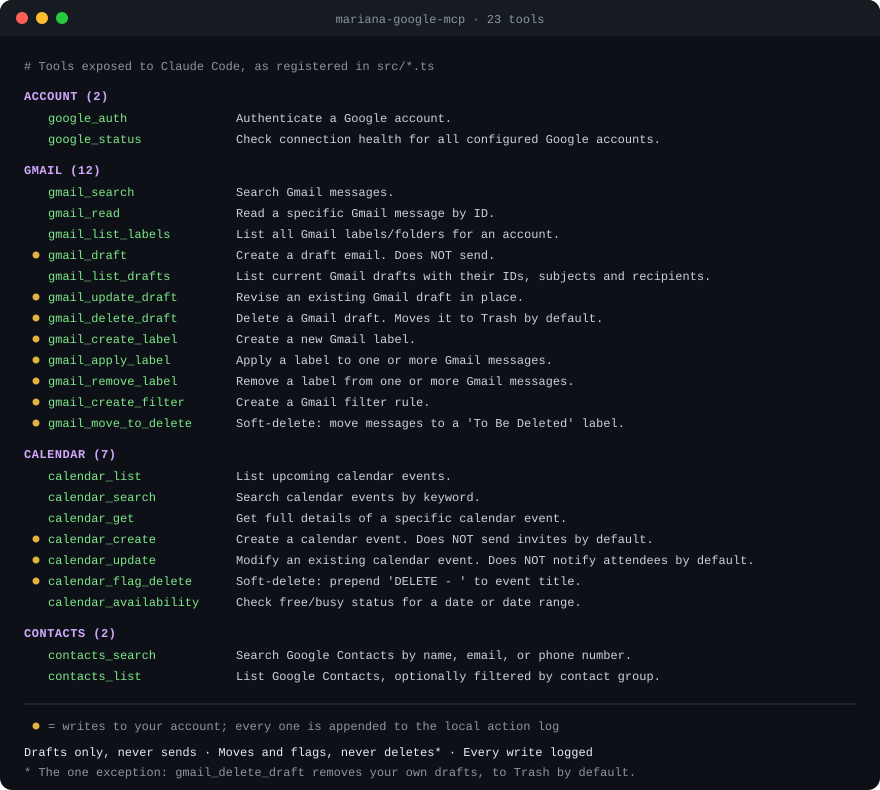

# mariana-google-mcp

A custom MCP (Model Context Protocol) server that gives Claude Code access to Gmail, Google Calendar, and Google Contacts, with safety-first defaults. The agent can read and draft, but nothing leaves your account without you. There is no send tool, no filter tool, and the server never sends calendar invites or updates. Mail and events are labeled or flagged, never deleted. The one removal is your own unsent drafts, which go to Trash (recoverable). Every write is logged, including failed and refused attempts.

**Who this is for:** operators who want Claude to help run their Google inbox and calendar, while sending and deleting stay in their own hands.

These are the guarantees the code enforces. Where one depends on your own configuration (for example, how broad you make `attachmentRoots`), the section below says so. See [What this does not protect against](#what-this-does-not-protect-against) for the limits.

[](LICENSE)
[](https://claude.com/claude-code)
[](https://github.com/marianasmall/mariana-google-mcp/commits/main)



*The 22 tools this server gives Claude Code, with abridged descriptions. Dotted tools write to your account and are logged.*

## Quick start

```bash
git clone https://github.com/marianasmall/mariana-google-mcp.git
cd mariana-google-mcp
npm install && npm run build
```

Then add the server to Claude Code and run `google_auth` (steps 3 and 4 under [Setup](#setup)). You need your own Google Cloud OAuth credentials first (step 1).

## Design Philosophy

This server is built for an operator who wants AI to help manage their Google workspace without risk of accidental damage:

- **No sending email.** You can draft, but sending requires manual action in Gmail. There is no send tool and no filter tool (filters can forward mail, so `gmail_create_filter` was removed).
- **No deleting your mail.** Gmail uses a "To Be Deleted" label (soft-delete). Calendar prepends "DELETE - " to event titles. You review and confirm in the Google UI. The single exception is your own unsent drafts (`gmail_delete_draft`), which move to Trash (recoverable for 30 days). There is no permanent-delete option.
- **No trashing or spamming through labels.** `gmail_apply_label` refuses the `TRASH` and `SPAM` labels. `gmail_remove_label` with `INBOX` archives a message; that is recoverable (the message stays in All Mail).
- **No invites.** Calendar writes always use `sendUpdates: "none"` (hardcoded, not a parameter), so Google never emails guests about events this server creates or changes.
- **Every write is logged.** An append-only JSONL action log records every write with timestamps, tool name, account, and summary. Failed and refused attempts are logged too.
- **Multi-account support.** Manage personal and work accounts with named aliases.

## Setup

**Easiest path:** paste this one line into Claude Code and it will run the entire setup for you, including guiding you through the Google Cloud clicks:

> Fetch https://raw.githubusercontent.com/marianasmall/mariana-google-mcp/main/SETUP-PROMPT.md and follow the instructions in it.

See [SETUP-PROMPT.md](SETUP-PROMPT.md) for what it does, including an optional phase that unifies triage across multiple accounts. The manual steps below cover the same ground.

### 1. Google Cloud Project

1. Go to [Google Cloud Console](https://console.cloud.google.com/)
2. Create a new project (or use an existing one)
3. Enable these APIs:
   - Gmail API
   - Google Calendar API
   - People API (for Contacts)
4. Create OAuth 2.0 credentials:
   - Application type: **Desktop app**
   - Download the client ID and client secret

### 2. Install and Build

```bash
git clone https://github.com/marianasmall/mariana-google-mcp.git
cd mariana-google-mcp
npm install
npm run build
```

### 3. Add to Claude Code

Add this to your `~/.claude.json` under `mcpServers`:

```json
{
  "mcpServers": {
    "mariana-google-mcp": {
      "type": "stdio",
      "command": "node",
      "args": ["/path/to/mariana-google-mcp/dist/index.js"],
      "env": {
        "GOOGLE_CLIENT_ID": "your-client-id.apps.googleusercontent.com",
        "GOOGLE_CLIENT_SECRET": "your-client-secret"
      }
    }
  }
}
```

Replace `/path/to/` with the actual path to your clone, and fill in your OAuth credentials.

### 4. Authenticate

After restarting Claude Code, run the `google_auth` tool. It will open a browser window for OAuth consent. Once authorized, your token is stored locally and refreshed automatically.

How the sign-in is protected:

- The consent callback listens on `127.0.0.1` only (a random local port), never on a network address.
- The flow uses a random `state` value and PKCE, so a forged or intercepted callback is rejected.
- An existing account name cannot be silently re-bound to a different Google account. Using a name that already belongs to another address is refused; pick a new name or remove the old one from `config.json` yourself.
- This needs a Google OAuth client of type **Desktop app**. A "Web application" client cannot register the random-port loopback redirect, and sign-in will fail.

### Scopes

The server requests exactly these six scopes (defined in `src/auth.ts`):

| Scope | Why |
|-------|-----|
| `userinfo.email` | Learn which Google account signed in |
| `gmail.modify` | Read mail, create and edit drafts, apply labels. Google's scope is broader than the tools use (on Google's side it also covers sending and trashing), so the limits come from the tools this server exposes, not from the scope |
| `calendar.events` | Create and edit events on calendars you own |
| `calendar.calendarlist.readonly` | Check that you own a calendar before writing to it |
| `calendar.freebusy` | The availability tool |
| `contacts.readonly` | Check that event guests are in your saved contacts |

### Re-consent after upgrading

Earlier versions also asked for full Calendar access (`calendar`) and Gmail settings access (`gmail.settings.basic`, which is what allowed filters). Upgrading the code does not shrink a token you already have: it keeps the old, broader grant until you sign in again. Re-run `google_auth` for each account after upgrading so the stored token carries only the six scopes above, then restart Claude Code so the rebuilt server loads. You can also remove the old grant at https://myaccount.google.com/permissions before signing in again.

## Available Tools (22)

### Authentication & Status
| Tool | Description |
|------|-------------|
| `google_auth` | Authenticate a Google account via OAuth browser flow |
| `google_status` | Check connection health for all configured accounts |

### Gmail (11 tools)
| Tool | Description |
|------|-------------|
| `gmail_search` | Search messages using Gmail query syntax |
| `gmail_read` | Read a specific message by ID (full content) |
| `gmail_list_labels` | List all Gmail labels/folders |
| `gmail_draft` | Create a draft email: plain text or rich HTML body, optional file attachments, optional reply-in-thread via `reply_to_message_id` (does NOT send) |
| `gmail_create_label` | Create a new label (supports nesting with `/`) |
| `gmail_apply_label` | Apply a label to one or more messages (refuses `TRASH` and `SPAM`) |
| `gmail_remove_label` | Remove a label from one or more messages (removing `INBOX` archives; recoverable) |
| `gmail_move_to_delete` | Soft-delete: move messages to a "To Be Deleted" label |
| `gmail_list_drafts` | List current drafts with IDs, subjects, recipients, thread |
| `gmail_update_draft` | Revise a draft in place, preserving its thread and threading headers |
| `gmail_delete_draft` | Move a draft to Trash (30-day recovery). No permanent option |

### Calendar (7 tools)
| Tool | Description |
|------|-------------|
| `calendar_list` | List upcoming calendar events |
| `calendar_search` | Search events by keyword |
| `calendar_get` | Get full details of a specific event |
| `calendar_create` | Create an event (never sends invites; guests must be allowed, see [Calendar guests](#calendar-guests)) |
| `calendar_update` | Modify an existing event (never notifies guests; same guest rules) |
| `calendar_flag_delete` | Soft-delete: prepend "DELETE - " to event title |
| `calendar_availability` | Check free/busy status for a date range |

### Contacts (2 tools)
| Tool | Description |
|------|-------------|
| `contacts_search` | Search contacts by name, email, or phone |
| `contacts_list` | List contacts, optionally filtered by group |

## Multi-Account Support

You can authenticate multiple Google accounts with friendly names:

```
google_auth account_name: "primary"
google_auth account_name: "newsletters"
google_auth account_name: "work"
```

Most tools accept an optional `account` parameter. If omitted, they use the default account. Use `google_status` to see all configured accounts and their health.

## Configuration Files

All configuration is stored in `~/.config/mariana-google-mcp/`:

| File | Purpose |
|------|---------|
| `config.json` | Account registry (names, email hashes, defaults) plus the optional `attachmentRoots`, `allowedAttendees` and `allowedImageHosts` settings below |
| `tokens/<hash>.json` | OAuth tokens per account (auto-refreshed) |
| `action-log.jsonl` | Append-only log of all mutations |

Permissions: the config directory and `tokens/` are `0700`; `config.json`, the token files and the action log are `0600` (owner-only). The server re-applies these on every start and never follows a symlink when it does.

Tokens are stored under a hash of the email address, not the plaintext address, for a layer of indirection. The hash is an unsalted SHA-256. It only names the token file, so it is not a secret and is not meant to hide the address from someone who already has the config directory; salting it would orphan existing token files and force a re-consent, which is not worth it for a file name.

### Settings you can add to `config.json`

All three are optional. Edit `config.json` yourself. No tool changes these settings, and the attachment guard refuses to read the config directory.

```json
{
  "attachmentRoots": ["/absolute/path/to/outbox", "/absolute/path/to/proposals"],
  "allowedAttendees": ["partner@example.com", "assistant@example.com"],
  "allowedImageHosts": ["images.example.com"]
}
```

Add these next to the existing `accounts` entries, not instead of them. Folder paths must be absolute: the server does not expand `~`, and a root that does not resolve is simply ignored, so nothing from it can be attached.

**`attachmentRoots`** is the list of folders `gmail_draft` may attach files from. If you leave it out, the defaults are `~/Projects`, `~/Documents`, `~/Downloads`, `~/Desktop` and `~/Library/CloudStorage`. Listing your own folders replaces the defaults, so a narrow list (one dedicated outbox folder) is the safest choice. A guarantee depends on this: if you add a broad folder (your whole home directory, say), anything inside it that is not otherwise blocked can be attached to a draft. Regardless of the roots, these are always refused:

- anything inside the config directory or `tokens/`, or inside `~/.claude` or `~/.ssh`
- anything inside a hidden folder, or a hidden file
- files that look like keys or credentials (`id_rsa`-style names, `.pem`, `.key`, `.p12`, `.pfx`, `.keychain-db`, `.env*`, `credentials.json`, `token.json`)

The path is resolved to its real location first, so symlinks and `..` cannot be used to step outside a root. Every rejection returns the same message, so the error does not reveal whether a given file exists. Total attachment size is capped at 20MB.

**`allowedAttendees`** is a list of addresses that may be added as calendar guests even though they are not in your Google Contacts. See [Calendar guests](#calendar-guests). Default: empty.

**`allowedImageHosts`** is a list of hostnames whose images may appear in an HTML draft (`` only; CSS can never load anything). By default an HTML draft with a remote image is refused (see [Remote resources in HTML drafts](#remote-resources-in-html-drafts)). An entry lets an image through only if its URL is `https:`, its hostname equals the entry exactly (case does not matter), and it has no username, password, explicit port or trailing dot. There are no subdomain wildcards, so `example.com` does not allow `images.example.com`, and `http:` is never allowed. Use it for something like an email-signature logo hosted on your own domain. Only list hosts **you control**: whoever runs a listed host sees a request every time a draft is opened. Default: empty.

### Other input checks

- Carriage returns and line feeds are refused in `to`, `cc` and `bcc` (header injection), on both `gmail_draft` and `gmail_update_draft`. Line breaks in the `In-Reply-To` and `References` values are refused too.
- <a id="remote-resources-in-html-drafts"></a>**HTML drafts are checked against an allowlist** by `gmail_draft` and `gmail_update_draft`, because Gmail loads remote resources when the draft is opened. Anything outside the allowlist is refused (not stripped), and the draft saved is a clean re-written copy of the checked HTML. See "What this does not protect against" below.

## Calendar guests

The server never sends invites or updates (`sendUpdates` is hardcoded to `"none"`). Even so, a guest added to an event can see it on their own calendar if Google shows it to them, so guests are restricted:

- A guest must be in your **saved Google Contacts** ("My Contacts"), or be listed in `allowedAttendees`, or be your own address. "Other contacts" (people Gmail added because they emailed you) are deliberately not trusted, because a stranger could get themselves added by sending you mail. If an address is not allowed, the event is refused.
- Writes go only to calendars your account **owns**. Calendars shared with you by other people are refused.
- A calendar you own but have shared with others, or made public, will expose anything the agent writes there. Checking sharing would need the full calendar scope, which this build deliberately dropped.
- If an event already has a guest who is not allowed, `calendar_update` refuses to change the **title, description or location** (the guests would read the new text). Changing the time is still allowed.
- If the contacts lookup itself fails, the check fails closed: only `allowedAttendees` guests pass.

A side effect to know about: whether a create or update succeeds or is refused tells the agent whether an address is in your contacts. That is a small amount of information about your address book, and the agent can reach it by trying addresses.

## Action Log

Every write operation (drafts, label changes, calendar creates/updates, soft-deletes) is logged to `~/.config/mariana-google-mcp/action-log.jsonl` in this format:

```json
{"timestamp":"2026-04-03T10:30:00.000Z","tool":"gmail_draft","account":"primary","summary":"Draft created: subject='Meeting follow-up'"}
```

Failed and refused write attempts are logged as well, with an `outcome` of `"failed"` or `"refused"`. The message is short (about 300 characters), newlines are collapsed, and credential-shaped strings (bearer tokens, Google access and refresh tokens) are redacted. The log does not store request bodies or message text; a draft entry records the subject and the To, Cc and Bcc recipients.

The server only ever appends to the log. Review it anytime to audit what Claude has done. (Anything with write access to your account directory could edit it, so treat it as an audit aid, not tamper-proof evidence.)

## What this does not protect against

- **Opening a draft is enough to leak through remote images.** Gmail loads remote images and stylesheets as soon as you open a draft, with no click, so an injected instruction could hide your data in an image URL. That is why `gmail_draft` and `gmail_update_draft` read an HTML body with a standards-compliant HTML parser (parse5, the same parsing rules browsers follow) and accept only basic email formatting:
  - **Elements:** `html`, `head`, `body`, `meta` (with `charset` only), `p`, `br`, `div`, `span`, `b`, `strong`, `i`, `em`, `u`, `s`, `small`, `sub`, `sup`, `blockquote`, `pre`, `code`, `h1` to `h6`, `ul`, `ol`, `li`, `hr`, `a`, `img`, the table elements (`table`, `thead`, `tbody`, `tfoot`, `tr`, `td`, `th`, `caption`, `colgroup`, `col`), `center` and `font`. Anything else (`<style>`, `<script>`, `<iframe>`, `<link>`, `<base>`, `<svg>`, forms and so on) is refused.
  - **Attributes:** layout and text attributes (`dir`, `align`, `valign`, `width`, `height`, `colspan`, `rowspan`, `cellpadding`, `cellspacing`, `border`, `bgcolor`, `color`, `face`, `size`, `title`, `alt`, `lang`, `style`). Links: `<a href>` with an absolute `http`, `https`, `mailto` or `tel` address, plus `target` and `rel`. Images: `` set to a `cid:` attachment, a base64 `data:image` (png, jpeg, gif or webp), or an `https` URL on a host in `allowedImageHosts`. Everything else (`class`, `id`, `onclick` and other event handlers, `srcset`, `background`, ...) is refused.
  - **Inline CSS:** `style="..."` may set color, background color, font, text alignment and decoration, line height, letter spacing, padding, margin, borders, width and height, vertical alignment, display, white-space and list style. Values are plain words, numbers, colors and `rgb()`/`rgba()`. Anything that could load a file (`url(...)`, `image-set`, `@import`), CSS escapes, comments and line breaks are refused.

  HTML comments and doctypes are dropped, and the draft that gets saved is re-written from the checked document, so what Gmail receives is exactly what was checked. A URL typed as plain text in the body is fine, because text never loads anything. Plain-text drafts are unaffected.
- **A draft Claude prepared or edited.** Before sending any draft Claude created or changed, check To, Cc, Bcc and the attachments. An injected instruction could address a draft to a stranger or attach a file from an allowed folder, and `gmail_update_draft` can change a draft you wrote yourself.
- **Mail the agent reads.** Anything in your inbox or calendar can contain instructions aimed at the agent (prompt injection). The tools above limit what a hijacked agent can do, but they do not stop it from reading, labeling, archiving or drafting.
- **Anything else holding your token.** The `gmail.modify` scope can send mail at Google's level. This server never does, but another program with access to the token file could. That is why the tokens are `0600` and the config directory `0700`.
- **A broad `attachmentRoots`.** See above: you decide what is attachable.
- **A compromised machine or config.** Anyone who can edit `config.json` can widen `attachmentRoots` and `allowedAttendees`.

## Fork and Use

To use this with your own Google account:

1. Fork this repo
2. Create your own Google Cloud project and OAuth credentials (see Setup above)
3. Build and point your Claude Code config at your fork's `dist/index.js`
4. Run `google_auth` to authenticate

No code changes needed. All account-specific data lives in config files and environment variables.

## Tech Stack

- TypeScript
- `@modelcontextprotocol/sdk`: MCP protocol implementation
- `googleapis`: Google API client
- `google-auth-library`: OAuth2 token management
- `zod`: Input validation

## License

MIT
